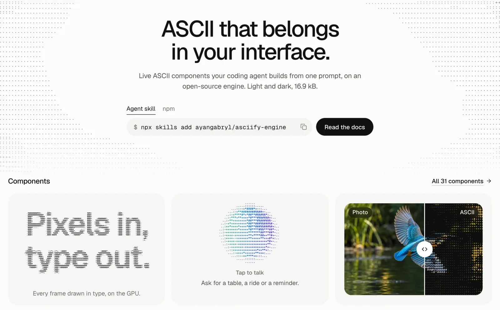

<p align="center">
  <a href="https://asciify.org">
    <picture>
      <source media="(prefers-color-scheme: dark)" srcset="https://raw.githubusercontent.com/ayangabryl/asciify-engine/main/.github/assets/logo-dark.png">
      <source media="(prefers-color-scheme: light)" srcset="https://raw.githubusercontent.com/ayangabryl/asciify-engine/main/.github/assets/logo-light.png">
      
    </picture>
  </a>
</p>

<p align="center">ASCII components, backgrounds and media for the web, drawn in real characters on the GPU.</p>

<p align="center">
  <a href="https://www.npmjs.com/package/asciify-engine"></a>
  <a href="https://bundlejs.com/?q=asciify-engine"></a>
  <a href="https://www.npmjs.com/package/asciify-engine"></a>
  <a href="https://github.com/ayangabryl/asciify-engine/blob/main/LICENSE"></a>
</p>

<p align="center">
  <a href="https://asciify.org">Website</a> ·
  <a href="https://asciify.org/docs">Docs</a> ·
  <a href="https://asciify.org/components">Components</a> ·
  <a href="https://asciify.org/editor">Studio</a>
</p>

<p align="center">
  <a href="https://asciify.org">
    <picture>
      <source media="(prefers-color-scheme: dark)" srcset="https://raw.githubusercontent.com/ayangabryl/asciify-engine/main/.github/assets/hero-dark.webp">
      <source media="(prefers-color-scheme: light)" srcset="https://raw.githubusercontent.com/ayangabryl/asciify-engine/main/.github/assets/hero-light.webp">
      
    </picture>
  </a>
</p>

Asciify is a framework-agnostic engine for ASCII on the web. Use it for interface components (loading buttons, toasts, tabs, AI states, charts, page transitions), for backgrounds behind your content, and for turning images, GIFs, video and text into characters. Components take their ink from your CSS tokens in light and dark, follow their element's size and radius, honour reduced motion and pause off screen.

## Install

```bash
npm i asciify-engine
```

Building with a coding agent? Add the skill, then describe what you want:

```bash
npx skills add ayangabryl/asciify-engine
```

## Quick start

```ts
import { buttonLoading } from 'asciify-engine/kit';
import { asciify } from 'asciify-engine';

const save = buttonLoading(document.querySelector('#save')!);
save.start('Saving');
await saveDraft();
save.succeed('Saved');

const stop = await asciify('/photo.jpg', document.querySelector('canvas')!, {
  fontSize: 8,
  options: { colorMode: 'fullcolor' },
});
// On unmount: save.destroy(); stop();
```

## Features

- **Kit** (`/kit`): interface components and the curated asciify.org backgrounds, one call each.
- **Media** (`asciify-engine`, `/core`): images, GIFs, video, webcam and text to ASCII on a canvas, with scroll-scrubbed video, chroma key and source crop.
- **GPU fields** (`/field`): full-bleed WebGL2 character fields with trail, fluid and lantern cursor responses, in any font and charset. Bring your own design with **custom effects** (a few lines of GLSL for your own hovers, reveals and motion, tweenable with GSAP or Motion), and draw **live 3D**: a three.js or React Three Fiber canvas becomes characters every frame.
- **Headless** (`/headless`): pixels to text with no DOM, in Node, workers and edge runtimes, for OG images, emails, CLIs and READMEs. Shape-aware: edges become `/ \ | _ ( )`, not just denser dots. Text, ANSI colour, SVG and HTML output; 4.7 kB.
- **Hover and motion** (`/hover`): pointer effects and still-image motions for media on your page.
- **Studio** (`/studio`): render styles, tonal curves, source warps, layered projects and PNG, JPEG, GIF, MP4 and WebM export.
- **Agent skill**: the house design, every component's prompt and snippet, and the full API, for Claude Code, Cursor, Codex and other agents.
- **Built for host pages**: no work at import, safe under SSR, tree-shaken per component, TypeScript types, ESM and CommonJS.

## How it compares

Measured against aalib.js, ascii.rest (the Cloudflare-sponsored ASCII library), three.js `AsciiEffect`, the postprocessing `ASCIIEffect`, @sister.software/asciify and a naive ramp, on the same pictures and grid, with photos the engine was not tuned on: ahead of every renderer tested on photographs, line art and type, close up and at a distance (better than aalib on both measures on 15 of 20 photos), and about six times faster than aalib. On the GPU, a glyph field with `FIELD_PHOTO_CHARSET` and `sample: 'shape'` is ahead of the studio WebGL heroes measured (2025.unseen.co's ASCII pass and webgl-ascii-hero) on photos, line art and type, close up and at a distance, and a playing source never makes it wait on the GPU. Method, numbers and the weak spots are in the [benchmark report](docs/benchmarks/2026-11-04-ascii-renderers.md).

## Stability

How things look is part of the API: patch releases never change rendered output, and CI compares every kit component, preset and field mark with stored screenshots. See [STABILITY.md](STABILITY.md) for versioning, deprecation and the runtime promises, and [SECURITY.md](SECURITY.md) to report a vulnerability.

## Docs

Everything else lives at **[asciify.org/docs](https://asciify.org/docs)**: the API reference, options, framework guides, chroma key, layering, Studio and GPU fields. The agent skill's [references](skills/asciify-engine/references) cover the same ground for agents.

## Performance

Each optional entry loads only when imported, and a route that uses one kit component downloads that component, not the whole kit. What the engine promises a host page, and how it is measured, is in [performance.md](skills/asciify-engine/references/performance.md).

## Contributing

Issues and pull requests are welcome. To work on the engine:

```bash
npm ci
npm test
npm run build
```

`npm run test:visual` checks the visual baselines and `npm run test:browser` serves the browser regression page; see [CONTRIBUTING.md](CONTRIBUTING.md). Changes are listed in [CHANGELOG.md](CHANGELOG.md).

## Sponsors

<!-- sponsors:start -->

<p align="center"><a href="https://asciify.org/sponsor"><picture><source media="(prefers-color-scheme: dark)" srcset="https://cdn.asciify.org/sponsors-dark.svg"></picture></a></p>

<p align="center"><sub>Backers: <a href="https://releasetime.io/">ReleaseTime</a></sub></p>

Asciify is free and open source. [Become a sponsor](https://asciify.org/sponsor).

<!-- sponsors:end -->

## License

[MIT](LICENSE) © ayangabryl
