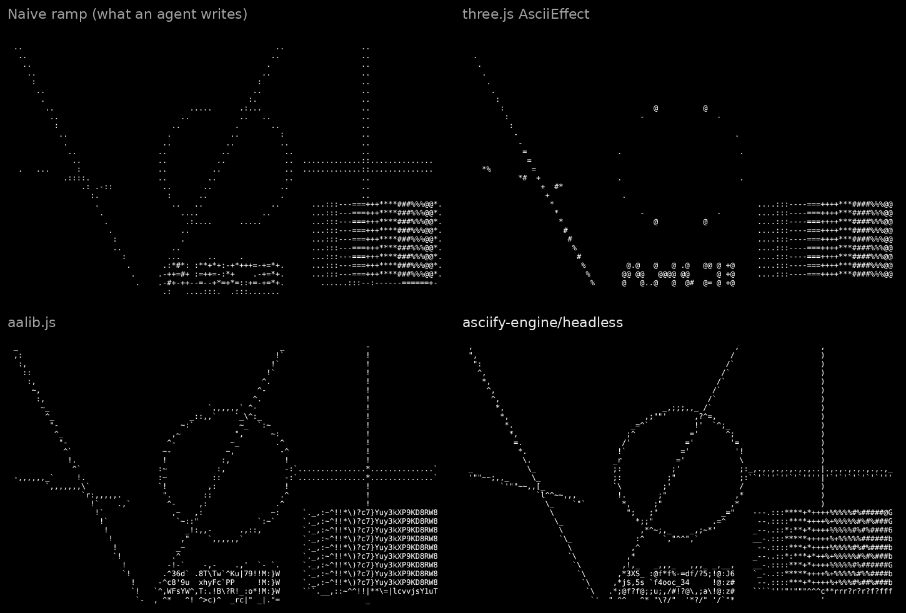
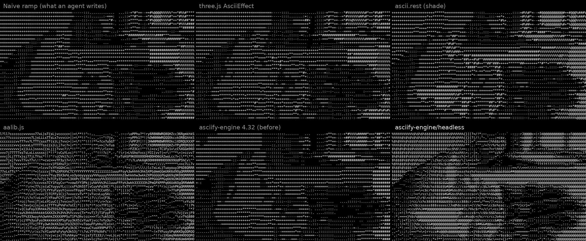
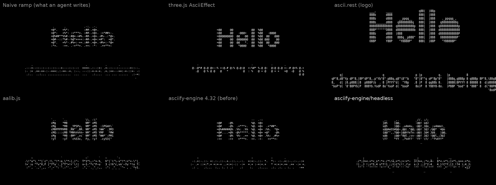

# asciify-engine against other ASCII renderers

November 4, 2026. asciify-engine 4.33.0, three 0.187.0, postprocessing 6.39.6, ascii.rest 0.4.0, @sister.software/asciify
3.1.3, aalib.js 2.0.0. Raw numbers: [2026-11-04-ascii-renderers.json](2026-11-04-ascii-renderers.json). Reproduce with
`cd bench && npm i && node compare.mjs --images <dir>`, `node size.mjs` and `node three-live.mjs`.

## Summary

| | asciify-engine/headless | aalib.js | ascii.rest (shade) | three.js AsciiEffect | naive ramp (agent baseline) |
| --- | --- | --- | --- | --- | --- |
| Photos, 20 unseen (SSIM close / far) | **0.593 / 0.878** | 0.534 / 0.868 | 0.418 / 0.781 | 0.446 / 0.779 | 0.427 / 0.750 |
| Line art | **0.846 / 0.876** | 0.799 / 0.798 | 0.686 / 0.847 | 0.718 / 0.601 | 0.737 / 0.674 |
| Type | **0.902 / 0.889** | 0.876 / 0.868 | 0.786 / 0.846 | 0.874 / 0.836 | 0.841 / 0.810 |
| 1920×1080 frame to 160 columns | 29 ms | 427 ms | 167 ms | 336 ms | 27 ms |
| Flicker on a slow pan (cells per frame) | 25 % stills, **3.8 %** video settings | 34 % | 7 % | 7.8 % | 4.7 % |
| Pixels to text in Node, no DOM | **yes** | no | yes | no | (if written to) |
| Minified + gzipped | 4.7 kB | 8.6 kB | 9.1 kB | 130.8 kB (with three) | — |

On photographs, line art and type it is ahead of every renderer tested, close up and at a distance, and better than aalib on
both measures on 16 of the 20 photos; it does it several times faster than aalib, with a quarter of its flicker in video
settings, in a 4.7 kB entry that also runs on a server. ascii.rest's `logo` style (drawn for
logos on a plain ground) scores 0.367 / 0.728 on photos, 0.746 / 0.778 on line art and 0.805 / 0.829 on type.

**About "Cloudflare's ASCII":** there is no ASCII renderer from Cloudflare. ascii.rest, a library of ASCII pieces that
Cloudflare sponsors (it is made by @bas3line), has an image-to-characters drawing (`drawing()` in `ascii.rest/kit`, the one
its /make/ page uses), and that is what is measured here, in both of its picture styles.

## What was measured, and how

**Same grid for everyone.** Each renderer turns the same picture into the same grid: 100 columns, rows from the picture's
aspect and a 1.93 cell (DejaVu Sans Mono at line-height 1), light characters on a dark ground: three.js's effect with
`invert`, aalib with its input inverted (as its own `inverse` filter does). ascii.rest sizes its own grid and trims a plain
ground away; its margin is cut off and it is scored against the same trimmed part of the picture.

**Fidelity.** Text output is drawn back in one font (DejaVu Sans Mono, 12 px, white on black), so only the choice of
characters differs. The drawing and the picture are both blurred to a viewing distance, "close" (σ half a cell) and "far"
(σ one and a half cells), and compared with SSIM. The blur averages light, as the eye does; the JSON also has the scores
with the blur in pixel values.

**Tuned on some photos, measured on others.** asciify-engine's weights were tuned on 20 photos from the asciify.org looks
library (every third one) and the line and type images. The photo scores above are on 20 different photos from the same
library (the next one along each time), which the tuning never saw.

**Speed.** Median of seven conversions of a 1920×1080 frame to 160 columns, after a warm-up, in Chromium on one core.

**Flicker.** The photo panned 0.15 of a cell per frame for 24 frames; the share of cells whose character changes. "Video
settings" are `dither: 'ordered'` with each frame given the previous one (`previous`).

**Size.** esbuild, minified, gzipped, of each library's minimal use (`node bench/size.mjs`).

Not measured: TheZoraiz/ascii-image-converter, a popular Go command-line converter, could not be run in the environment the
benchmark was made in (an unvetted downloaded binary).

## ASCII generators: ascii-magic.com and devault-ascii.pages.dev

The two most used free image-to-ASCII generators on the web are apps rather than libraries. Their ASCII styles were rebuilt
in `bench/page.js` from the code their sites ship (November 2026), with their default settings, and drawn in one ink on the same
grid and font as everyone else:

- **ASCII Magic** (ascii-magic.com), Characters mode: the picture drawn down to the grid, each cell's brightness set between the
  picture's darkest and lightest, cells under its dark threshold (30) left empty, then `@#S08Xx+=-;:. ` by brightness. As shipped
  it also lays a blurred copy of the photo under the characters, which is left out here: it would score the photo, not the ASCII.
- **Devault** (devault-ascii.pages.dev), Classic (its default, `@%#*+=-:. `) and Detailed (a 70-character ramp): auto levels, a 6 %
  cutoff, and its edge pass on: a structure-tensor edge finder that puts `-`, `/`, `|` or `\` on strong edges and lifts the rest.

| | Photos (close / far) | Line art | Type | Flicker | 1080p frame, main thread |
| --- | --- | --- | --- | --- | --- |
| **asciify-engine GPU text** (`createAsciiGpu`) | **0.596 / 0.884** | **0.861 / 0.880** | **0.897 / 0.889** | 24 %, **3.8 %** video | **0.50 ms** (0.43–0.60); video **0.46** |
| asciify-engine GPU text, `mode: 'tone'` | 0.568 / 0.880 | 0.797 / **0.950** | 0.881 / **0.940** | **3.2 %** video | **0.45 ms** (0.41–0.59); video **0.43** |
| asciify-engine/headless (CPU) | 0.592 / 0.879 | 0.846 / 0.876 | 0.902 / 0.889 | 25 %, 3.8 % video | 44 ms |
| asciify-engine `imageToAsciiGrid`, `mode: 'tone'` (CPU) | 0.567 / 0.877 | 0.820 / 0.894 | 0.889 / 0.916 | 3.2 % video | 38 ms |
| Devault, Detailed | 0.425 / 0.786 | 0.713 / 0.871 | 0.813 / 0.871 | 36 % | 147 ms |
| Devault, Classic | 0.420 / 0.765 | 0.728 / 0.845 | 0.833 / 0.862 | 6.8 % | 154 ms |
| ASCII Magic, Characters | 0.366 / 0.639 | 0.706 / 0.573 | 0.875 / 0.842 | 9.4 % | 3.4 ms (2.55–4.17) |

Times are main-thread time to convert a 1920×1080 frame to 160 columns, a fresh frame every time as with video. For the GPU
converter and ASCII Magic they come from Chrome's own trace (`node bench/speed.mjs`): every task the page's main thread ran
while each converted 8 fresh frames, garbage collection included, over 15 runs taken in turn; the table gives the median
and, in brackets, the fastest and slowest run. The other rows time the synchronous call (median of 5,
`node bench/compare.mjs`). Raw numbers: [2026-11-05-gpu-text.json](2026-11-05-gpu-text.json),
[2026-11-05-gpu-text-speed.json](2026-11-05-gpu-text-speed.json).

The GPU converter works in a worker by default: the page hands each frame over (a video's current frame as a `VideoFrame`,
anything else as an `ImageBitmap` the browser copies off the main thread) and gets the grid back as a message; uploading,
matching, diffusing and reading back all happen in the worker. Its slowest run of the 15 (1.30 ms, a garbage collection
included) is half ASCII Magic's fastest (2.55 ms). Where workers are unavailable or blocked by a page's content policy it
runs on the page instead, at 1.1 to 2.2 ms.

asciify-engine is ahead of both on every picture at both distances, in every mode, and with its video settings it flickers
least (3.2 % of cells a frame on a slow pan in tone mode and 3.8 % in shape mode, against 6.8 % and 9.4 %, while scoring 0.916
and 0.923 on the moving picture against 0.828 and 0.682). The GPU converter takes less of the main thread than ASCII Magic's
one-pixel-a-cell reading in every mode, diffusion included, while matching every cell by shape.

Two changes made that true for diffusion and for tone mode:

- **Diffusion settled on the GPU.** Floyd–Steinberg passes each cell's leftover tone to the cells right of it and below, so a
  cell's error depends only on cells above and to its left. The GPU runs the match four times: each pass, every cell takes the
  error its neighbours left in the pass before, picks its character and leaves its own. Cells near the top-left corner are
  exact after four passes and the rest carry nearly settled errors. It scores higher than walking the true sequence on the
  CPU (photos 0.596 / 0.884 against 0.592 / 0.879, line art 0.861 against 0.846 up close), and only one byte a cell comes back.
- **Tone mode reads edges.** Each cell's tone is taken a little steeper (contrast × 1.15) and pushed away from its eight
  neighbours' average (a cell-wide unsharp mask, 0.75), so a stroke's edge cells go dense or empty instead of mid-grey. On
  the GPU, photos went from 0.542 / 0.872 to 0.568 / 0.880, line art from 0.770 / 0.943 to 0.797 / 0.950 and type from
  0.864 / 0.931 to 0.881 / 0.940. On the CPU, `imageToAsciiGrid` now draws tone mode down to 2 by 2 pixels a cell and averages
  them exactly, so thin lines do not alias.

On the GPU, the glyph field with `sample: 'shape'` scores 0.618 / 0.922, 0.852 / 0.917 and 0.915 / 0.961 (see the studio
heroes below).

### On screen, live: the frame a page actually draws

Both generators draw their characters on the page, so the cost that drops frames is converting and drawing, on the main
thread, every frame. `node bench/perf.mjs --sizes 1920x1080 --cells 6,3.5 --only "rebuilt|imageToAsciiGrid|GPU field"` draws
a live 1080p source (repainted every frame) with each, at about 160 and 275 columns, and times the main thread per frame
(median; Chromium with SwiftShader). The generators are given the benefit of the doubt: ASCII Magic's characters are stamped from
a glyph atlas rather than drawn with `fillText`, and Devault's WebGL draw is not counted at all. Raw numbers:
[2026-11-05-live-frame.json](2026-11-05-live-frame.json).

| Main thread per frame, 1080p | 12 px cells | 7 px cells |
| --- | --- | --- |
| **asciify-engine GPU field** (shape sampling, bloom, fluid hover) | **0.9–1.5 ms** | **0.9 ms** (4 px cells) |
| ASCII Magic (convert + draw) | 125 ms | 299 ms |
| Devault Classic (convert only) | 364 ms | 272 ms |
| asciify-engine `imageToAsciiGrid` + atlas draw, tone | 206 ms | 463 ms |

The GPU field does its sampling, shape matching, hover and bloom on the GPU, so its main-thread cost stays flat however small
the cells (re-measured after the field stopped re-checking its read-back framebuffer every read: 4.2 ms became about 0.9); drawing characters one by one on a 2D canvas grows with every cell. On the same 20 photos the field with
`sample: 'shape'` scores 0.618 / 0.922 (line art 0.852 / 0.917, type 0.915 / 0.961), ahead of both generators on every
measure. GPU time under SwiftShader is not a real GPU's and is not compared.

## Studio heroes: 2025.unseen.co and an open-source WebGL hero

Big design sites draw their ASCII heroes with a WebGL shader. Two are measured here against asciify-engine's GPU field, on the
same 20 unseen photos, line art and type:

- **2025.unseen.co** (Unseen Studio): its ASCII pass, rebuilt in `bench/page.js` from the shader and settings in its live bundle
  (`js-265ae611.js`): one pixel sampled per 12 px square cell, greyscaled, a character picked by brightness from
  `" .,-+=*UNSEEN2025"` (56 px Arial in a 16 by 16 atlas), in `#575757`, with a fluid trail under the cursor (left out here).
- **webgl-ascii-hero** (open source, MIT, a React Three Fiber + postprocessing hero): its effect run unchanged from
  `bench/vendor/`, which samples one pixel per square cell and picks from a 16-character atlas.

Each is scored as shipped and "neutral" (white characters on dark, the same grid as everyone else); neutral is the fair one.

| | Photos (close / far) | Line art | Type |
| --- | --- | --- | --- |
| asciify-engine field, `FIELD_PHOTO_CHARSET`, `glyphScale: 1`, `sample: 'shape'` | **0.618 / 0.922** | **0.852 / 0.917** | **0.915 / 0.961** |
| asciify-engine field, `FIELD_PHOTO_CHARSET`, `glyphScale: 1` | 0.581 / 0.918 | 0.783 / 0.889 | 0.875 / 0.954 |
| asciify-engine field, defaults (tuned for interfaces) | 0.407 / 0.875 | 0.736 / 0.847 | 0.840 / 0.876 |
| 2025.unseen.co ASCII pass, neutral | 0.533 / 0.812 | 0.759 / 0.674 | 0.870 / 0.814 |
| 2025.unseen.co ASCII pass, as shipped (grey `#575757` characters) | 0.311 / 0.348 | 0.662 / 0.448 | 0.790 / 0.662 |
| webgl-ascii-hero, neutral | 0.479 / 0.645 | 0.772 / 0.688 | 0.885 / 0.842 |
| webgl-ascii-hero, as shipped (inverted, purple) | 0.499 / 0.666 | 0.727 / 0.586 | 0.800 / 0.688 |

Both studio shaders choose a character by brightness alone from one sampled pixel, so they alias and do not follow edges. The
field averages each cell and, with the measured 24-step charset, holds more of the picture at both distances; with
`sample: 'shape'` it also reads each cell in 3 by 5 parts on the GPU and, among the characters within three steps of the cell's
tone, takes the one whose ink lies where the picture's light does (cells with no edge in them keep their tone's character).
That is what puts it ahead on type up close, where plain tone sampling (0.875) was behind webgl-ascii-hero (0.885). Its three
constants were tuned on the 20 training photos, line art and type; the photo scores above are on the 20 held-out photos.

### Frame cost

`node bench/perf.mjs` draws a live source (a canvas repainted every frame, standing in for a playing video) at 1920×1080 and
3840×2160 device pixels with 12, 4 and 1 px cells, the pointer moving every frame, and times each frame from the repaint to the
result being finished on the GPU, less an idle frame. Each cell is the median frame in ms / the slowest main-thread frame in
ms, in Chromium with SwiftShader (the GPU emulated on the CPU), November 5, 2026. Raw numbers:
[2026-11-05-frame-cost.json](2026-11-05-frame-cost.json).

| | 1080p 12 px | 1080p 4 px | 1080p 1 px | 4K 12 px | 4K 4 px | 4K 1 px |
| --- | --- | --- | --- | --- | --- | --- |
| asciify-engine field, no hover | 178 / 19 | 227 / 5.2 | 248 / 10.2 | 872 / 12.1 | 975 / 12.4 | 1011 / 9 |
| asciify-engine field, fluid hover | 225 / 9.3 | 212 / 11.6 | 275 / 5.2 | 847 / 9.4 | 880 / 11.7 | 883 / 10.3 |
| asciify-engine field, `sample: 'shape'`, fluid hover | 193 / 5.2 | 240 / 6.4 | 265 / 10.3 | 765 / 5.5 | 929 / 14.4 | 1000 / 9.2 |
| asciify-engine field, fluid hover, `scope: 'subject'` | 197 / 10.4 | 225 / 12.2 | 266 / 17.2 | 802 / 11.7 | 872 / 14 | 964 / 10 |
| 2025.unseen.co ASCII pass (its fluid trail left out) | 160 / 0.2 | 185 / 0.3 | 158 / 0.2 | 715 / 0.2 | 660 / 0.2 | 691 / 0.2 |
| webgl-ascii-hero | 310 / 1.5 | 331 / 1.6 | 311 / 1.5 | 1183 / 1.1 | 1366 / 1.1 | 1388 / 1.7 |

- **Main thread: no stalls.** Before this release a playing source read a canvas copy back on the CPU to measure its levels
  and hover scope; at 1080p that blocked frames for up to 76 ms (and every frame with `scope: 'subject'`). Those reads now come
  back from the GPU without waiting, and the slowest main-thread frame above is 5 to 19 ms under emulation, where the field's
  copy to its canvas also runs on the CPU. The studio shaders draw straight into their own canvas and do less on the main
  thread (0.1 to 1.7 ms).
- **GPU work:** the field asks for about 1.1 to 1.6 times the work of the bare 2025.unseen.co pass, which samples one pixel per
  cell with no hover (its fluid trail is left out of the rebuild), and 0.6 to 0.85 times webgl-ascii-hero's. The field also
  averages each cell, runs the fluid, and copies each frame to the field's own canvas, which is what lets every field on a page
  share one WebGL context.
- **Big hovers cost the same as small ones:** the fluid runs on a fixed grid whatever its radius, and each cell reads it once.
  Shape sampling adds little at 12 px cells and nothing below 8 device px, where it samples as `area`.
- Emulated times compare the work asked for; they say nothing about a real GPU's speed, which was not measured.

### Footprint: memory and the whole browser's CPU

`node bench/screen.mjs --seconds 5 --runs 3` draws a live 1080p source with each renderer, each in a fresh page, for 5 seconds (3 runs).
It reads every Chrome process's proportional memory (PSS, from `/proc`, so the GPU and renderer processes count) and the CPU
time all of Chrome took, alongside the main thread's CPU time per frame. Medians, Chromium with SwiftShader, so CPU time
includes the emulated GPU's work and frame rates are low. Raw numbers:
[2026-11-05-footprint-1080.json](2026-11-05-footprint-1080.json).

| 1080p, live source | Memory, all of Chrome | Main thread, CPU ms a frame | Chrome's CPU, cores busy |
| --- | --- | --- | --- |
| The page alone (source repainted, nothing drawn) | 345 MB | 0.32 | 1.94 |
| **asciify-engine field, still image** | **382 MB** | **0.33** | **2.04** |
| **asciify-engine field in a worker** | **400 MB** | **0.51** | **3.47** |
| asciify-engine field on the page | 400 MB | 0.76 | 3.48 |
| ASCII Magic (rebuilt): convert + draw | 379 MB | 17.6 | 3.27 |
| webgl-ascii-hero | 423 MB | 0.96 | 3.70 |
| 2025.unseen.co ASCII pass (rebuilt) | 479 MB | 0.57 | 3.65 |

- A still field costs the page almost nothing once drawn: it draws again only when something changes (the pointer, a resize,
  a theme), so it adds 37 MB and no measurable CPU over the bare page.
- A live field takes less memory than either studio shader and less of the main thread than any other renderer here. Its
  whole-browser CPU is within the noise of the others: under emulation it is mostly the GPU's work, which is not a real GPU's.
  ASCII Magic takes less memory because it draws on a 2D canvas with no WebGL context, at 17.6 ms of main thread a frame.
- **No leaks** (`node bench/leak.mjs`): 48 mounts and destroys of live 1080p fields (6 a round, 8 rounds) level off after the first round: own
  context 245 → 258 MB, shared context 299 → 311 MB, worker 270 to 288 MB (garbage collection), about 0.3 MB a mount at most
  and falling. A field that made its own WebGL context gives it back when it goes.

## cloudflare.com's dot hero

cloudflare.com's home hero ("Build without boundaries") is not drawn live: its field of small ticks with a warm glow is a
pre-rendered video, `static/hero-background-video.mp4` (2560 by 1600, 8 s, **5.08 MB**), behind a 17.8 kB AVIF poster. The page
compiles no WebGL shaders for it.

`bench/cf-hero.mjs` draws the same hero live with asciify-engine's glyph field: one tick character per cell on a 9 by 17 grid,
coloured by the orange ground and glow beneath it, each tick lifted toward white by a four-line custom effect
(`defineFieldEffect`). Scored against a frame of their video at 1280 by 800, it is near-identical at a distance (SSIM **0.998**;
mean colour 255, 97, 34 against their 253, 97, 32). Close up the score is low (about 0.35) because a grid of ticks shifted by
part of a cell scores badly pixel for pixel; it is the same pattern, not the same pixels.

| | cloudflare.com (video) | asciify-engine (live field) |
| --- | --- | --- |
| Bytes for the hero | 5.08 MB video + 17.8 kB poster | 43 kB gzipped field code, no media |
| Resolution | fixed 2560 by 1600, scaled to fit | drawn at the screen's own resolution |
| Interaction, theme, reduced motion | none (a loop) | cursor responses, CSS-token ink, stills under reduced motion |

## Pixel renderers (GPU and canvas)

These draw pixels rather than text, each in its own font, so they are scored on what they drew (same metric), photos:

| | close | far |
| --- | --- | --- |
| asciify-engine glyph field (`/field`, GPU, defaults) | 0.407 | 0.875 |
| asciify-engine glyph field, `FIELD_PHOTO_CHARSET`, `sample: 'shape'` | **0.618** | **0.922** |
| postprocessing ASCIIEffect (defaults) | 0.285 | 0.301 |
| @sister.software/asciify (block mosaic) | 0.547 | 0.792 |

postprocessing tints each glyph by the scene's colour by default, which is why it reads dark here. @sister.software/asciify
fills each cell with a block and cuts the glyph out of it, a mosaic rather than text, so it is listed apart.

## Command-line tools: jp2a and chafa

`node bench/cli-compare.mjs --images <dir>` runs `asciify-engine`'s command, jp2a 1.1.1 (`--background=dark`) and chafa
1.14 (`--symbols ascii -c none --stretch`) on the same PNG, each asked for exactly the same columns and rows of plain
characters, light on dark. The text is scored as every renderer above is: drawn in DejaVu Sans Mono and compared with the
picture by SSIM up close and at a distance. The pictures are 20 photos from the asciify.org looks library that the engine was
not tuned on (sorted by name, every third starting from the second), plus the line art and type images. Raw numbers:
[2026-11-06-cli.json](2026-11-06-cli.json).

| Command, 100 columns | Photos | Line art | Type |
| --- | --- | --- | --- |
| **asciify-engine** (shape) | **0.593 / 0.878** | **0.846** / 0.876 | **0.902** / 0.889 |
| **asciify-engine --tone** | 0.577 / **0.883** | 0.812 / **0.916** | 0.896 / **0.910** |
| jp2a 1.1.1 | 0.493 / 0.795 | 0.745 / 0.674 | 0.870 / 0.828 |
| chafa 1.14, ASCII symbols | 0.445 / 0.700 | 0.793 / 0.742 | 0.899 / 0.872 |

One of the engine's modes is best on every picture, up close and at a distance (44 of 44). Chafa is built for colour and for
terminal graphics protocols (sixel, kitty, iTerm), which this table does not measure; its plain-ASCII mode is what is scored
here. ascii-image-converter was not measured (its Go build could not be installed here).

## Live 3D

`node bench/three-live.mjs` renders a three.js torus knot each frame and draws it with a glyph field (`live: true`,
`redraw()` after each render). The characters follow the scene, and the source is read back on the CPU only when its levels
are re-measured (about every 1.5 s), not every frame; before `live`, `setSource` each frame read it back twice a frame.

## Where it is not ahead

- **Photos at a distance:** ahead of aalib on average by a small margin (0.878 against 0.868); on 4 of the 20 photos aalib is better on at least one measure.
- **Flicker on stills:** the default (error diffusion) is the most faithful for a still but changes many cells between similar
  frames (25 %); use `dither: 'ordered'` and `previous` for video and animation (3.8 %, below a plain ramp's 4.7 %).
- **Where workers are blocked** (a content policy without `blob:` workers), the GPU converter runs on the page at 1.1 to 2.2
  ms a frame, which overlaps ASCII Magic's 1.9 to 3.2 ms in that mode's runs.
- **`imageToAsciiGrid` on a frame held by the GPU:** it draws the frame down on a 2D canvas and reads it back, which waits for
  the GPU (34 ms here under SwiftShader for a fresh 1080p frame in tone mode, about 2 ms for one already in memory). For video
  use `createAsciiGpu`, which never waits.
- **A thin horizontal or vertical line on a cell edge** can come out as `;:;:` or `)` where aalib draws dots or `!`.
- The glyph table is measured from DejaVu Sans Mono; the art matches most closely in that family and its relatives.
- GPU frame times on real hardware were not measured: the runs use SwiftShader, which compares the work each renderer asks for
  but says nothing about a real GPU's speed.
